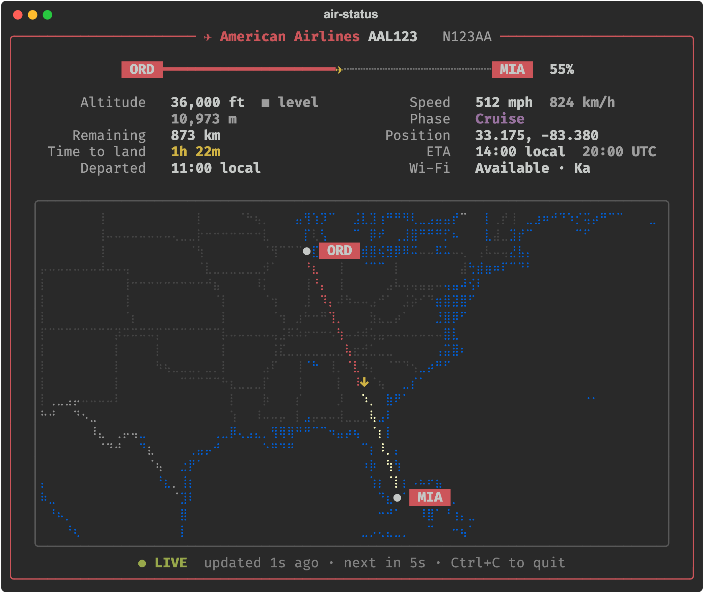

# air-status

Live flight status in the terminal while you're on board, read from the airline's
in-flight Wi-Fi portal: altitude, speed, ETA, a Braille map of the route, and a
saved history of every flight.



<sub>Made-up flight. Regenerate with `.venv/bin/python scripts/screenshot.py`.</sub>

## Setup

```bash
python3 -m venv .venv
.venv/bin/pip install -e '.[dev]'
```

## Use

```bash
.venv/bin/air-status                     # live view, airline detected from the Wi-Fi, saves history
.venv/bin/air-status live -p aircanada --every 10
.venv/bin/air-status live -p american     # American Airlines (Viasat aircraft)
.venv/bin/air-status history             # list saved flights
```

Run it in a real terminal for the live full-screen view. In a plain output window
(e.g. PyCharm's Run tab) it prints one frame per update instead.

Files go in the current folder (change with `--data-dir`):

- `history/<provider>/` — one file per flight, in that provider's own format.
  Air Canada (Gogo) stores the raw portal data as change-only JSON Lines: the
  first line is the full reading, later lines hold only the fields that changed.
  Your device's IP/MAC address is never saved.
  American Airlines stores the Viasat flight feed plus the route's airport
  locations (looked up once from the portal) in the same change-only format.
  Its feed has no vertical speed, so climb/descent is worked out from the
  altitude change over the last minute (and saved too).
- `mapdata/` — map outlines from [Natural Earth](https://www.naturalearthdata.com/),
  downloaded on first run.

The map draws the flown path from history (solid red). Where there is no history,
such as before recording started or during gaps over 60 s, it draws an estimated
shortest-path line between the known points (dashed red).

## Adding an airline

Providers live in `src/air_status/providers/`. A provider:

- `fetch()` — gets a raw reading from its portal,
- `parse(reading)` — turns it into the shared `FlightStatus` (`models.py`),
- `history(directory)` — returns its `FlightHistory` (`flightlog.py`), which
  decides how readings are written and read back. Reuse `ChangeLog` for
  change-only JSON Lines, or implement your own format.

Auto-detect (the default, `-p auto`) asks every provider's portal at once via
`detect()` and uses the first that returns flight data. The default `detect()`
is "fetch and parse succeed"; override it when portals are shared (Gogo
providers also check `airline_code`).

Same Wi-Fi system as an existing provider (e.g. another Gogo/Intelsat airline):
subclass it and set `id`, `name` and `airline_code`, like `aircanada.py`. Then add an instance
to `PROVIDERS` in `providers/__init__.py`.

## Tests and lint

```bash
.venv/bin/pytest
.venv/bin/ruff check .
.venv/bin/ruff format .
```

GitHub Actions (`.github/workflows/ci.yml`) runs the same lint plus tests on
Python 3.9–3.14 for every push to `main` and every pull request.
